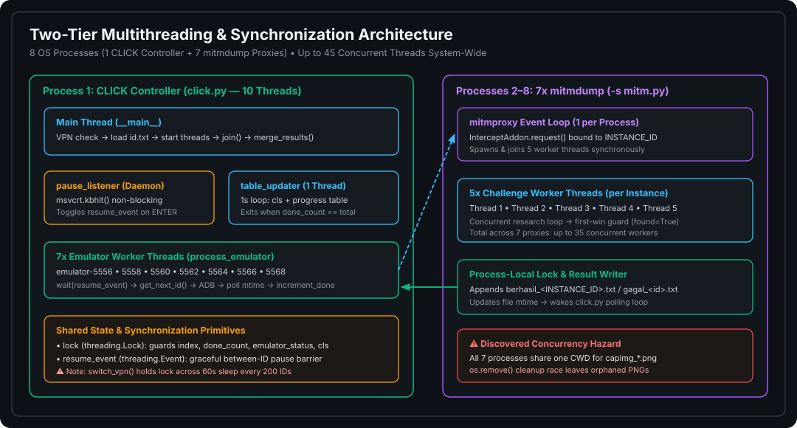
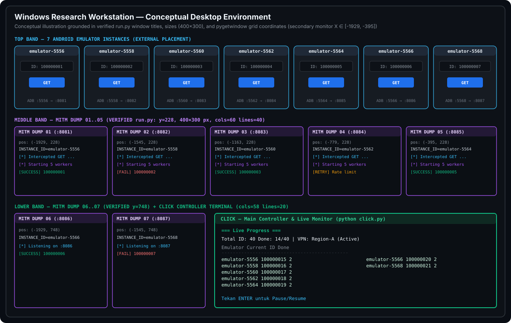

> **Scope Note:** This article documents the engineering architecture and security research findings from an Application Security & Automation environment I built for authorized internal research. All production domains, credentials, real account data, original CAPTCHA challenge images, and operational bypass scripts remain private. All figures quoted from log files and diagrams below refer to a **sample execution snapshot** (sample evidence) from a single session.

## 1. How It Started

In 2024, while working as a Security Consultant, I spent a lot of time diving into mobile application security. That included understanding how Android apps work under the hood, analyzing client-server communication, and inspecting the security controls built into them.

Around that time, I received an offer for a project that eventually became my next role. Let's call that position **Application Security & Automation Researcher**.

At first, I expected the job to focus mainly on mobile application security research. Once I understood the full scope, though, another interesting challenge came up: not just analyzing how the app worked, but handling workflows involving many accounts with repetitive execution paths.

Doing everything manually was out of the question. Opening the app, interacting with the UI, and processing accounts one by one inside an emulator quickly became impractical as the account count grew.

At the same time, it was not as simple as writing a script to click through screens automatically. The application under study used anti-automation controls, including a slider CAPTCHA, which became one of the central challenges in the research.

From there, the work grew into a mix of mobile reverse engineering, application security research, and automation engineering. I needed to understand the app's internal mechanics while building an automation system capable of running those workflows in parallel.

Eventually, I put together a multi-instance automation environment on Windows: seven Android emulators running at the same time, seven `mitmdump` processes mapped 1:1, and one central terminal named **CLICK** to control everything.

## 2. Why Seven Emulators at Once?

You might wonder:

"Why not just hit the API directly with Python instead of bothering with seven Android emulators?"

Not that simple! I had the same thought at first. In practice, however, many mobile apps tie sensitive flows to temporary session tokens, UI state, and triggers generated inside the app itself. Running those flows inside an Android environment kept behavior closer to the real application and made observation easier during research.

The catch was that a single emulator hit two bottlenecks right away. First, the delay from UI interactions to network round-trips made testing slow. Second, I needed multiple sessions running in parallel to observe how the application behaved under concurrent execution.

So I decided to run seven Android emulator instances concurrently. That let me distribute the work queue dynamically while keeping network traffic from each emulator isolated in its own interception process.

That is how the multi-instance automation setup took shape: not just launching several emulators side by side, but coordinating every instance without stepping on the others.

## 3. Research Environment Overview

The entire research environment ran on a single **Windows** host with a multi-monitor setup. Everything was controlled from one machine, with each component assigned its own role and workspace.

The host ran seven Android emulator instances, from `emulator-5556` through `emulator-5568` on even ADB port numbers. Each emulator ran the custom Android app under study. To keep traffic from mixing across instances, each emulator routed through its own local proxy on ports `8081` through `8087`.

To connect and control all components, I used **Python** with three main scripts:

1. **`run.py` — Launcher**

   Launches all `mitmdump` processes and the main terminal. I used `pygetwindow` to position and size each CMD window so every process stayed visible across the multi-monitor layout.

2. **`click.py` — Main Controller**

   The control center for the whole environment. It managed ADB communication with the emulators, network connection checks, and task distribution using `threading`. I named the terminal running this script **CLICK**.

3. **`mitm.py` — mitmproxy Addon**

   Loaded by each `mitmdump` process. Each instance listened on its own port and handled traffic from the emulator paired with it.

With responsibilities split this way, each component stayed focused: `run.py` handled startup and window layout, `click.py` ran orchestration, and `mitm.py` handled network traffic observation.

Even though everything lived on one Windows host, the setup did not rely on one big monolithic process doing everything at once.

## 4. Complete System Architecture

The diagram below shows the multi-instance automation architecture running on one workstation. There are **15 active windows** in total: seven Android emulators, seven `mitmdump` terminals, and one main **CLICK** terminal.


From the start, I kept each script's responsibilities separate so the workflow stayed easy to manage.

`run.py` acted strictly as a launcher. It opened the seven `mitmdump` terminals, arranged their positions on screen, and then launched the main **CLICK** terminal running `click.py`.

Once every process was up, `run.py` was done and exited. Ongoing control stayed with `click.py` and the seven running `mitmdump` processes.

In short, `run.py` prepared the environment, `click.py` coordinated the automation, and each `mitmdump` instance handled network traffic for its assigned emulator.

## 5. Managing Seven Android Emulators in Parallel

Coordinating seven emulators via ADB (`adb -s emulator-55XX shell ...`) comes with a trap. If you split the ID list statically upfront, a slower emulator can leave the other six sitting idle once they finish their batches early.

To avoid that, I used a **shared dynamic work queue** in `click.py`.

All IDs from `id.txt` were loaded into a shared queue called `all_ids`. The seven worker threads pulled the next ID through `get_next_id()`, guarded by `threading.Lock()` so two threads could never grab the same ID at once.

With that setup, each emulator immediately grabbed the next task as soon as it finished the current one. Faster emulators naturally processed more IDs, and slower ones never held up the rest of the queue.

Alongside the shared queue, I kept a strict 1:1 mapping between each worker, Android emulator, `mitmdump` terminal, and proxy port so every worker kept its own dedicated device and traffic channel.


This made workload sharing far more flexible than static splitting. No emulator sat waiting on another's batch while IDs remained in the queue.

## 6. Traffic Interception with Seven `mitmdump` Processes

Instead of pointing all seven emulators at a single `mitmdump` instance and having to sort out which request came from which device, I ran seven separate `mitmdump` processes.

Each process used a different port from `8081` to `8087`, launched with the `-q` (quiet mode) flag to keep noisy default logs out of the terminal and leave the output focused on what the addon printed.

To identify each process cleanly, I set the `INSTANCE_ID` environment variable before starting `mitmdump`.

For example:

```bat
set INSTANCE_ID=emulator-5556 && mitmdump -q -s mitm.py -p 8081
```

## 7. Slider CAPTCHA Security Research: Analysis, Findings, and Recommendations

One of the most interesting challenges in this project was an image-based **slider CAPTCHA** protecting sensitive flows in the application.

While observing network traffic through `mitmdump` and inspecting the challenge-ticket lifecycle, I noticed that the CAPTCHA service delivered a PNG sprite sheet with fixed dimensions of **`340 x 600` pixels** in 8-bit RGBA format.

Visually, each sprite sheet contained three vertical areas:

1. **Top area:** The intact background image scrambled into 10 vertical strips (vertical strip scrambling).
2. **Middle area:** The same scrambled background pattern, overlaid with the puzzle cutout shadow.
3. **Bottom area:** A single puzzle piece placed at a fixed horizontal position on the left side of the canvas.


*Illustration: Generic visualization of the slider CAPTCHA layout to help explain the research process. This image is not a screenshot of the original application and is not test evidence. Artwork has been replaced to keep the application anonymous.*

From that structure came the core question of the research:

> "Are 10-strip vertical scrambling and a slider puzzle like this strong enough to stop automation?"

After analyzing how it worked, I found two architectural weaknesses in the mechanism under study.

First, both the background image and the puzzle piece were delivered inside a single sprite sheet with a relatively deterministic layout and geometry. That opened the door to programmatic visual analysis using computer vision techniques, including grayscale template matching.

Second, based on the verification behavior observed within the testing scope, server-side validation appeared to focus mainly on the matched horizontal offset value. I saw no indication of sufficient checks on behavioral telemetry, such as touch drag paths, speed variation, or device attestation.

**As a result, I successfully bypassed the slider CAPTCHA mechanism automatically** using parallel image analysis inside the authorized research environment.

This shows that scrambling an image into 10 vertical strips is not enough on its own to prevent automation if the visual layout and verification check remain predictable.

To keep this post focused on security analysis, I have intentionally left out cropping coordinates, offset scaling formulas, service endpoints, and the operational scripts used during testing.

### Mitigation Recommendations

Based on these findings, developers can strengthen similar CAPTCHA implementations with a few layered controls:

- **Behavioral Telemetry Validation**

  Do not validate only the final slider coordinate. The server should also evaluate interaction signals such as drag trajectory, velocity changes, touch consistency, and completion timing as part of a broader risk assessment rather than treating them as standalone proof of a human user.

- **Asset Decoupling and Dynamic Obfuscation**

  Avoid relying on a fixed visual asset structure. Separating assets, varying geometry, adding dynamic distortion, and applying randomized per-session transformations raise the cost of automated visual analysis.

- **App and Device Attestation**

  For Android apps, CAPTCHA flows can be paired with the Play Integrity API or similar device attestation mechanisms, with attestation results bound securely to the session and challenge token so they cannot be replayed.

- **Layered Risk Scoring**

  CAPTCHA should not be the only line of defense. Combine challenge verification with other risk signals protecting sensitive endpoints, including session anomaly detection and unusual request-pattern analysis.

One clear lesson from this research is that a CAPTCHA that looks tricky to a human is not necessarily hard for a machine. In application security, visual complexity does not equal strong verification.

## 8. The `CLICK` Terminal and Network Management

The **CLICK** terminal (`click.py`) served as the central console for the entire environment, coordinating the work queue, worker states, and network configuration.

When `click.py` started, it paused with `time.sleep(5)` so all seven `mitmdump` processes could finish initializing and start accepting emulator connections.

The controller then checked host VPN status via `vpn_status()`. If a VPN was already connected, it adopted the active server name; otherwise, it initiated a connection via `connect_vpn()`.

In this authorized research environment, I also integrated a VPN management module with `vpn_status()`, `connect_vpn()`, and `switch_vpn()`. Region switching ran periodically after every 200 completed items.

This setup was used to observe how consistently the application behaved across different network contexts and egress regions during testing sessions.

### Interactive Pause and Resume

Beyond process and network control, the **CLICK** terminal supported **Pause/Resume** so runs could be controlled interactively.

This ran on a `pause_listener()` daemon thread. On Windows, I used `msvcrt.kbhit()` to read keyboard input without blocking the main process.

Pressing `ENTER` triggered a pause via `resume_event.clear()`. Workers currently handling an ID finished that item first, then paused cleanly before the next iteration.

Once paused, execution could be resumed without tearing down the whole setup. That made it much easier to take a quick break or inspect environment state without closing every active terminal window.

## 9. Multithreading, Synchronization, and Monitoring

At the thread level, the environment used two concurrent layers running at the same time.



### Concurrency in `click.py`

Inside `click.py`, **10 threads** were involved in running the controller:

- **1 Main Thread:** Ran the primary controller flow and coordinated overall execution.
- **7 Emulator Worker Threads:** Each handled tasks for one dedicated Android emulator.
- **1 `table_updater` Thread:** Refreshed the progress table in the terminal every second for live monitoring.
- **1 `pause_listener` Daemon Thread:** Watched for keyboard input to handle Pause/Resume without blocking the main process.

### Internal `mitmdump` Concurrency

The second layer ran inside each `mitmdump` process, configured with `num_threads = 5` to handle work concurrently.

With seven separate `mitmdump` processes running side by side, each instance had its own internal concurrency pool.

### Synchronization Between `click.py` and `mitm.py`

One quirky detail in this setup was how `click.py` knew `mitm.py` had finished processing an ID.

Instead of talking directly over sockets or a message queue, both scripts used file modification timestamps (`mtime`) as the completion signal.

Before triggering a submission through the emulator, `click.py` recorded the last modified timestamp of that emulator's output file, then polled `os.path.getmtime()` once per second until the timestamp changed.

This kept coordination simple without adding extra IPC plumbing, though it meant synchronization latency depended on file writes and the polling interval.

### Merging Results

Once the work queue emptied, the main thread waited for all seven worker threads to finish via `.join()`, along with the `table_updater` thread so monitoring closed cleanly.

The controller then called `merge_results()` to combine the per-emulator logs into two final output files:

- `berhasil_all.txt`
- `gagal_all.txt`

This pulled results from all seven emulators into one place for easier review and follow-up analysis.

## 10. Reading the Sample Execution Evidence

For documentation and auditability, I included a provided execution snapshot consisting of a sample input file (`id.txt`), logs from one instance (`berhasil_emulator-5556.txt` and `gagal_emulator-5556.txt`), and three sample challenge images (`capimg_*.png`).

To be clear, these files are a **representative sample from part of a test session**, not the full project dataset. All numbers discussed in this section reflect only the included sample.

Logs from `emulator-5558` through `emulator-5568` were omitted from this sample package, not because those emulators went unused, but simply to anchor the write-up to one representative evidence set.

### Reading the Sample Logs

Looking at the included sample, a few details stand out:

- Sample `berhasil_emulator-5556.txt` recorded **3 successful entries**.
- Sample `gagal_emulator-5556.txt` recorded **19 failure lines** across **14 unique IDs**.
- Sample `id.txt` contained **40 unique IDs**.
- Three `capimg_*.png` images were 8-bit RGBA PNGs measuring `340 x 600` pixels.

In the failure log, two main server response categories showed up: mismatched answers and request throttling.

Notably, all three IDs listed as successful in the success sample had also appeared earlier in the failure sample, pointing to retries or entries recorded across different sessions.

That matches opening log files in append mode (`'a'`) without deduplication, keeping older lines intact whenever new results are appended to the same file.

### Sample Terminal Output

To show what the **CLICK** dashboard looked like, I included the synthetic terminal output illustration below. The values shown are synthetic rather than real logs and do not represent full test results.


## 11. Desktop Workstation Layout

With seven Android emulators and eight terminal windows open at once, screen layout mattered so everything stayed easy to watch.

Using `run.py`, the seven `MITM DUMP` windows were arranged automatically via `pygetwindow`, each sized at `400 x 300` pixels on the left secondary monitor:

- Five windows along the top row at `y = 228`.
- Two windows along the bottom row at `y = 748`.
- Horizontal positions (`x`) spanning from `-1929` to `-395`.

Meanwhile, the seven Android emulators sat across the upper workstation area, with the **CLICK** terminal below them as the central control console.



The diagram above is a conceptual layout built from the window coordinates and dimensions configured in `run.py`, used instead of target-app screenshots so the write-up stays focused on environment architecture without exposing the application UI.

## 12. Closing Thoughts

Building a multi-instance automation environment while researching slider CAPTCHA weaknesses was a rewarding engineering experience. It reinforced that application security research is not only about finding bugs, but understanding how every piece works together, from network traffic and app internals to concurrency in the automation tooling itself.

There was plenty to learn from orchestrating seven emulators at once, managing processes with Python multithreading, and analyzing anti-automation controls using computer vision.

To keep the work educational without exposing sensitive parts, I documented a sanitized architecture and simulation version in a separate repository. That public repo focuses on multi-emulator orchestration, multithreading, and desktop automation patterns without any operational scripts from the original research environment.

For me, the best part of the project was not just running seven emulators in parallel or bypassing a CAPTCHA check, but seeing how all the moving pieces connect and run together as one system.

If you have built mobile automation labs or studied anti-automation protections from another angle, I am always happy to discuss and exchange notes.

---

**GitHub Repository (Sanitized Version):** [aldisaw/android-security-research-automation](https://github.com/aldisaw/android-security-research-automation)
