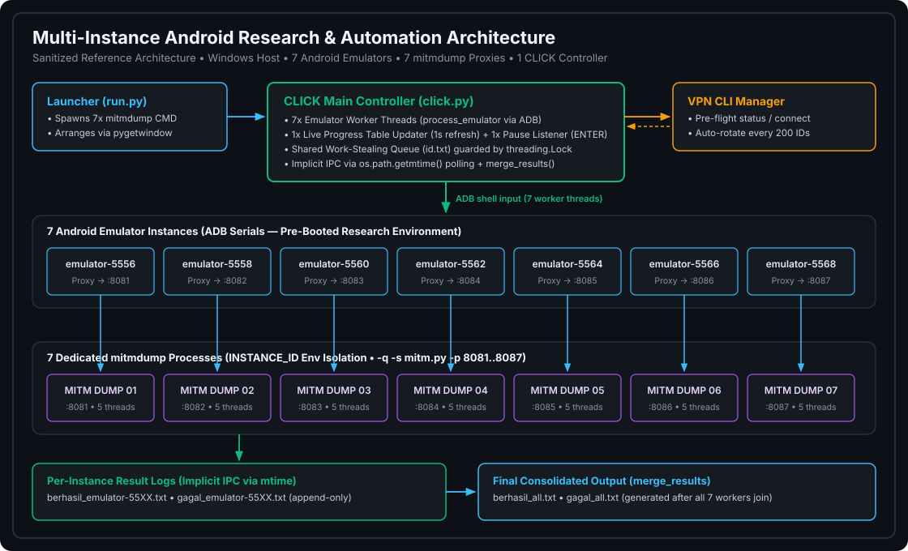
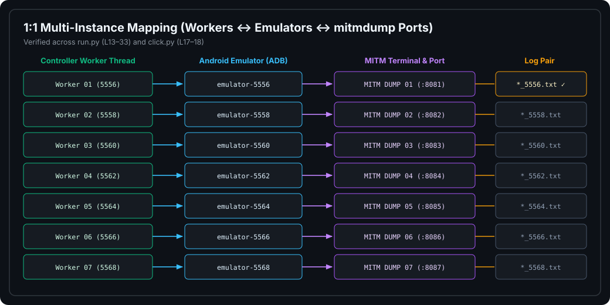
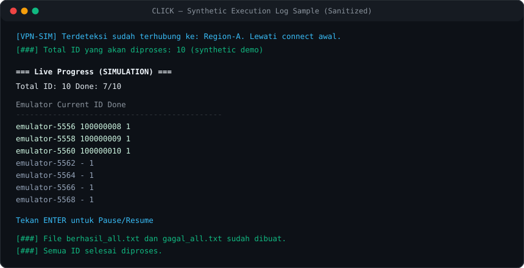

> **Scope Note:** This article documents the *engineering* architecture and security research findings from an Application Security & Automation environment I built for authorized internal research. All production domains, credentials, real account data, original CAPTCHA challenge images, and operational *bypass* scripts remain private. All figures quoted from log files and diagrams below refer to a **sample execution snapshot** (*sample evidence*) from a single session.

## 1. How It Started

In 2024, while still working as a *Security Consultant*, I was in a phase where I was deeply interested in *mobile application security*—from understanding how Android applications operate and analyzing client-server communication, to examining the security mechanisms implemented inside them.

During that period, I received an offer for a project that eventually became my next role. Let's refer to that position as **Application Security & Automation Researcher**.

Initially, I expected the role to focus mostly on mobile application security research. However, once I understood the scope of the work, an equally interesting engineering challenge emerged: not only understanding how the application behaved, but also handling workflows involving many accounts with repetitive execution paths.

Running everything manually was obviously not a practical option. Imagine opening an application, interacting with the UI, and processing accounts one by one inside an emulator. As the number of accounts grew, that approach became far too slow.

At the same time, the process was not as simple as writing a script to tap buttons automatically. The application under study employed *anti-automation* mechanisms, including a *slider CAPTCHA*, which became a key focus in the research process.

From there, the work evolved into a combination of *mobile reverse engineering*, *application security research*, and *automation engineering*. I needed to understand the internal mechanics of the application while building an automation system capable of managing those workflows in parallel.

Eventually, I built a *multi-instance* automation environment on Windows: seven Android emulators running concurrently, seven `mitmdump` processes mapped 1:1, and one central terminal named **CLICK** controlling everything.

## 2. Why Seven Emulators at Once?

Some people might ask:

"Why not just hit the API directly with Python instead of going through the trouble of running seven Android emulators?"

Not so fast! I thought the same thing at first. In practice, however, many mobile applications bind sensitive flows to *temporary tokens*, UI *state*, and triggers generated from inside the app itself. Running the flow inside an Android environment therefore provided behavior much closer to the real application and made observation easier during research.

The challenge was that running just one emulator came with clear bottlenecks. First, latency from UI interactions to *network round-trips* slowed down testing considerably. Second, I needed an environment where multiple sessions could run in parallel so application behavior under concurrent conditions could be observed.

As a result, I chose to run seven Android emulator *instances* concurrently. With this setup, the work queue could be distributed dynamically while *traffic* from each emulator remained separated through its own interception process.

That is how the *multi-instance automation* concept took shape—not merely running multiple emulators side by side, but coordinating every instance without interfering with the others.

## 3. Research Environment Overview

The entire research *environment* ran on a single **Windows** host with a *multi-monitor* layout. All core components were controlled from one machine, while each had its own isolated role and workspace.

The host ran seven Android emulator *instances*, from `emulator-5556` through `emulator-5568` using even ADB *port* numbers. Each emulator ran the custom Android application under study. To prevent *traffic* across emulators from mixing, each instance routed through its own local *proxy* on *ports* `8081` through `8087`.

To tie all components together and control them, I used **Python** across three main scripts:

1. **`run.py` — Launcher**

   Responsible for launching all `mitmdump` processes and the main terminal. I used the `pygetwindow` library to position and size each CMD window so every process could be monitored cleanly across the *multi-monitor* setup.

2. **`click.py` — Main Controller**

   The central control hub of the entire environment. It handled communication with the emulators over ADB, network connection management, and task distribution using `threading`. I named the terminal running this script **CLICK**.

3. **`mitm.py` — mitmproxy Addon**

   Loaded by each `mitmdump` process. Every instance ran on its own *port* and processed *traffic* from its paired emulator.

With this separation of concerns, each component had a clear responsibility: `run.py` handled process startup and window layout, `click.py` acted as the main orchestrator, and `mitm.py` handled *network traffic* observation.

Even though everything ran on a single Windows host, the environment did not depend on one monolithic process doing everything at once.

## 4. Complete System Architecture

The diagram below summarizes the *multi-instance automation* architecture running simultaneously on a single workstation—**15 active windows** in total, consisting of seven Android emulators, seven `mitmdump` terminals, and one primary **CLICK** terminal.



From the beginning, I separated each script's responsibilities so the overall workflow remained clean and maintainable.

`run.py` served strictly as a *launcher*. It opened the seven `mitmdump` terminals, arranged their window positions across the monitor, and then launched the main **CLICK** terminal running `click.py`.

Once all processes were up, `run.py` finished its job and exited—subsequent control was handled entirely by `click.py` alongside the seven active `mitmdump` processes.

In short, `run.py` prepared the environment, `click.py` coordinated automation execution, and each `mitmdump` instance inspected the *network traffic* of its assigned emulator.

## 5. Managing Seven Android Emulators in Parallel

Coordinating seven emulators via ADB (`adb -s emulator-55XX shell ...`) comes with a classic pitfall: if the ID list is split statically upfront, one slower emulator can finish last while the other six sit idle waiting.

To avoid that bottleneck, I implemented a **shared dynamic work queue** inside `click.py`.

All IDs from `id.txt` were loaded into a shared queue named `all_ids`. The seven *worker threads* fetched the next ID through `get_next_id()`, with queue access synchronized via `threading.Lock()` so two threads could never pull the same ID concurrently.

With this mechanism, each emulator immediately picked up the next task upon finishing its current one. Faster emulators naturally processed more IDs, while slower ones did not stall the overall queue.

Alongside dynamic queue distribution, I maintained a strict 1:1 mapping across each *worker*, Android emulator, `mitmdump` terminal, and proxy *port* so every worker kept a dedicated emulator and *network traffic* channel.



This made workload distribution far more flexible than static partitioning—no emulator waited on another's batch as long as IDs remained in the queue.

## 6. Traffic Interception with Seven `mitmdump` Processes

Rather than routing all seven emulators through a single `mitmdump` instance and having to disentangle which request came from which device, I ran seven separate `mitmdump` processes.

Each process listened on a distinct port from `8081` to `8087`, launched with the `-q` (*quiet mode*) flag to suppress noisy default logs and keep terminal output focused on the addon's relevant output.

To distinguish each process's identity, I injected the `INSTANCE_ID` *environment variable* prior to starting `mitmdump`.

For example:

```bat
set INSTANCE_ID=emulator-5556 && mitmdump -q -s mitm.py -p 8081
```

## 7. Slider CAPTCHA Security Research: Analysis, Findings, and Recommendations

One of the most interesting challenges in this project was an image-based **slider CAPTCHA** mechanism protecting sensitive application flows.

While observing *network traffic* through `mitmdump` and analyzing the *challenge-ticket lifecycle*, I observed that the CAPTCHA service delivered a PNG *sprite sheet* with fixed dimensions of **`340 x 600` pixels** in 8-bit RGBA format.

Visually, each *sprite sheet* was composed of three vertical regions:

1. **Top area:** The intact background image scrambled into 10 vertical strips (*vertical strip scrambling*).
2. **Middle area:** The same scrambled background pattern, overlaid with the puzzle cutout shadow (*cutout shadow*).
3. **Bottom area:** A single puzzle piece placed at a fixed horizontal position on the left side of the canvas.


*Illustration: Generic visualization of the slider CAPTCHA layout to help explain the research process. This image is not a screenshot of the original application and is not test evidence. Artwork has been replaced to preserve application anonymity.*

From that structure, the central research question emerged:

> "Are 10-strip vertical scrambling and a slider puzzle mechanism like this sufficient to resist automation?"

After analyzing the implementation, I identified two architectural weaknesses in the mechanism under study.

First, both the background image and the puzzle piece were delivered together in a single *sprite sheet* with relatively deterministic structure and geometry. This made programmatic visual analysis feasible using *computer vision* techniques such as *grayscale template matching*.

Second, based on the verification behavior observed within the authorized testing scope, server-side validation appeared to focus primarily on the matched *horizontal offset* value. I observed no indication of sufficient supplementary checks on behavioral telemetry—such as touch trajectory paths, velocity variation, or *device attestation*.

**As a result, the slider CAPTCHA mechanism could be automated programmatically** via parallel image analysis inside the authorized research environment.

This finding illustrates that scrambling an image into 10 vertical strips alone is not necessarily enough to deter automation if the visual structure and verification model remain predictable.

To keep this publication focused strictly on security analysis, I have intentionally omitted cropping coordinates, *offset* scaling formulas, service *endpoints*, and operational testing scripts.

### Mitigation Recommendations

Based on these findings, developers can consider several layered defenses to strengthen similar CAPTCHA mechanisms:

- **Behavioral Telemetry Validation**

  Do not validate only the final slider coordinate. Servers should also evaluate interaction signals such as drag trajectory, velocity changes, touch-input consistency, and completion timing as risk inputs rather than relying on a single static check.

- **Asset Decoupling and Dynamic Obfuscation**

  Avoid relying on a fixed visual asset layout. Separating assets, varying geometry, introducing dynamic distortion, and applying per-session randomized transformations increase the cost of automated visual analysis.

- **App and Device Attestation**

  For Android applications, CAPTCHA flows can be combined with the *Play Integrity API* or comparable *device attestation* mechanisms, cryptographically binding attestation results to the session and challenge token so they cannot be reused.

- **Layered Risk Scoring**

  CAPTCHA should not serve as the sole defensive layer. Combine challenge validation with broader risk signals protecting sensitive *endpoints*, including session anomaly detection and abnormal request-pattern analysis.

One key takeaway from this research is that a CAPTCHA that looks tricky for humans is not automatically hard for machines—in application security, visual complexity does not equate to strong verification.

## 8. The `CLICK` Terminal and Network Management

The **CLICK** terminal (`click.py`) served as the central control console for the environment, coordinating the work queue, worker states, and network configuration.

At startup, `click.py` waited `time.sleep(5)` so all seven `mitmdump` processes could finish initializing and begin accepting connections from the emulators.

Next, the controller checked the host VPN status via `vpn_status()`. If already connected, it adopted the active server name; otherwise, it initiated a connection using `connect_vpn()`.

Inside this authorized research environment, I also integrated a VPN management module comprising `vpn_status()`, `connect_vpn()`, and `switch_vpn()`. Region switching occurred periodically after every 200 completed items.

This configuration was used to observe application behavior consistency across different network contexts and *egress* regions during testing sessions.

### Interactive Pause and Resume

Beyond process and network coordination, the **CLICK** terminal supported **Pause/Resume** so testing could be controlled interactively.

This ran on a `pause_listener()` *daemon thread*. On Windows, I used `msvcrt.kbhit()` to detect keyboard input without blocking the main thread.

Pressing `ENTER` triggered a pause via `resume_event.clear()`. Workers currently handling an item finished their active ID first and then paused cleanly before starting the next iteration.

Once paused, execution could be resumed without tearing down the entire environment—making it much easier to inspect emulator or proxy state mid-run without manually closing eight separate terminal windows.

## 9. Multithreading, Synchronization, and Monitoring

At the *thread* level, the environment used two concurrent layers running simultaneously.


### Concurrency in `click.py`

Inside `click.py`, **10 threads** ran concurrently:

- **1 Main Thread:** Executed the primary controller flow and coordinated startup/shutdown.
- **7 Emulator Worker Threads:** Each managed execution for one dedicated Android emulator.
- **1 `table_updater` Thread:** Refreshed the terminal progress table once per second for live monitoring.
- **1 `pause_listener` Daemon Thread:** Listened for keyboard input to toggle Pause/Resume without blocking execution.

### Internal `mitmdump` Concurrency

The second layer lived inside each `mitmdump` process, configured with `num_threads = 5` to handle concurrent flows.

With seven independent `mitmdump` processes running side by side, each instance maintained its own internal concurrency pool.

### Synchronization Between `click.py` and `mitm.py`

A notable detail in this implementation was how `click.py` detected that `mitm.py` had finished processing an ID.

Instead of direct IPC over *sockets* or a *message queue*, both scripts coordinated via file modification timestamps (*file modification time* or `mtime`).

Before triggering an emulator submission, `click.py` recorded the last modification timestamp of that emulator's output file, then polled `os.path.getmtime()` once per second until a change was detected.

This kept cross-process coordination simple without adding extra IPC infrastructure, at the trade-off of tying synchronization latency to file timestamps and the polling interval.

### Merging Results

Once the work queue drained, the *main thread* waited for all seven *worker threads* via `.join()`, followed by the `table_updater` thread so monitoring shut down cleanly.

Finally, the controller called `merge_results()` to consolidate the per-emulator logs into two combined output files:

- `berhasil_all.txt`
- `gagal_all.txt`

This gathered outputs from all seven emulators into one place for post-run review and analysis.

## 10. Reading the Sample Execution Evidence

For documentation and auditability, I included a representative execution snapshot (*provided execution snapshot*) consisting of a sample input file (`id.txt`), logs from one instance (`berhasil_emulator-5556.txt` and `gagal_emulator-5556.txt`), and three sample challenge images (`capimg_*.png`).

It should be emphasized that these files represent a **sample snapshot from part of a test session**, not the entire project dataset. All figures discussed here describe only that included sample.

Logs from `emulator-5558` through `emulator-5568` were not included in this sample package—not because those emulators were unused, but simply to keep documentation anchored to one representative evidence set.

### Reading the Sample Logs

From the included sample, several observations stand out:

- Sample `berhasil_emulator-5556.txt` recorded **3 successful entries**.
- Sample `gagal_emulator-5556.txt` recorded **19 failure lines** across **14 unique IDs**.
- Sample `id.txt` contained **40 unique IDs**.
- Three `capimg_*.png` images were 8-bit RGBA PNGs measuring `340 x 600` pixels.

In the failure log, two primary server response categories appeared: mismatched challenge answers and request *throttling* responses.

Interestingly, all three IDs recorded as successful in the success log sample had previously appeared in the failure log sample—reflecting retries or multi-session logging.

This behavior aligns with opening log files in append mode (`'a'`) without deduplication, preserving earlier records as new runs append to the same file.

### Sample Terminal Output

To illustrate what the **CLICK** dashboard looked like, I included the synthetic terminal output illustration below. The data shown is synthetic—not raw production logs—and does not represent full test results.



## 11. Desktop Workstation Layout

With seven Android emulators and eight terminal windows running simultaneously, screen organization mattered so everything could be monitored at a glance.

Through `run.py`, the seven `MITM DUMP` windows were arranged automatically via `pygetwindow`, each sized at `400 x 300` pixels on the left-hand secondary monitor:

- Five windows along the top row at `y = 228`.
- Two windows along the bottom row at `y = 748`.
- Horizontal positions (`x`) spanning from `-1929` to `-395`.

Meanwhile, the seven Android emulators occupied the upper workstation area, with the **CLICK** terminal positioned below them as the central control console.


The diagram above is a conceptual representation built from the window coordinates and dimensions configured in `run.py`, used instead of application screenshots so the documentation stays focused on environment architecture without exposing the target application UI.

## 12. Closing Thoughts

Building a *multi-instance* automation *environment* while researching *slider CAPTCHA* weaknesses was a rewarding engineering experience. It reinforced that application security research is not just about spotting isolated bugs—it is about understanding how every layer fits together, from network communication and application internals to concurrency in the tooling itself.

There was a lot to learn along the way: orchestrating seven emulators concurrently, managing processes with Python *multithreading*, and analyzing anti-automation protections through *computer vision*.

To keep the research educational without exposing sensitive components, I published a sanitized architecture and simulation repository separately, focusing on *multi-emulator* orchestration, *multithreading*, and *desktop automation* patterns without any operational scripts from the original research environment.

Ultimately, the most interesting part for me was not simply running seven emulators in parallel or identifying a CAPTCHA weakness, but understanding how all the moving pieces connect and operate together as a single system.

If you have built mobile automation *labs* or researched anti-automation defenses from a different angle, I am always open to discussing and exchanging notes.

---

**GitHub Repository (Sanitized Version):** [aldisaw/android-security-research-automation](https://github.com/aldisaw/android-security-research-automation)
