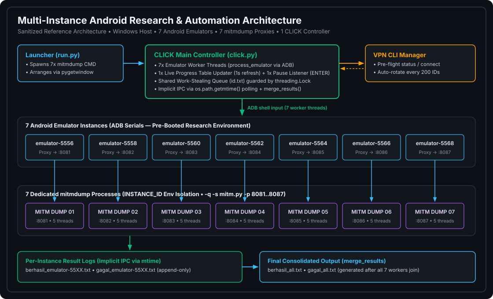
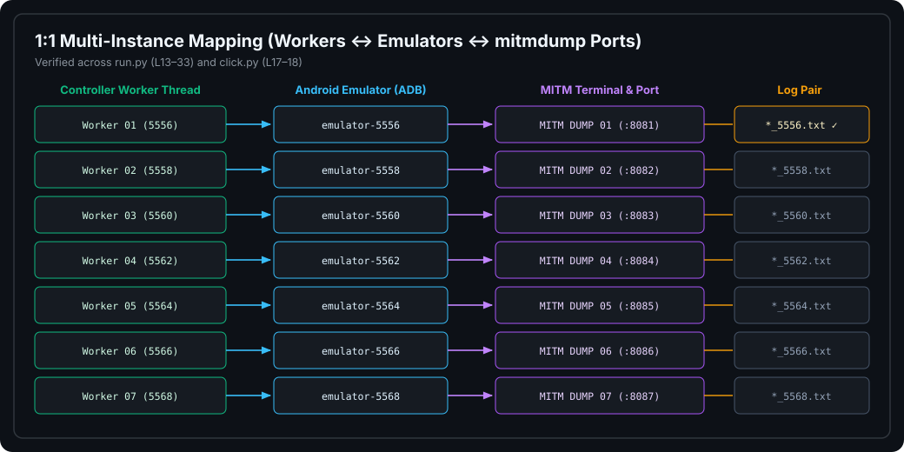
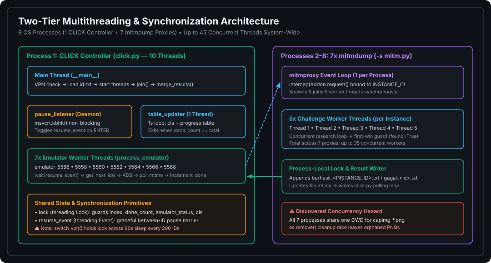
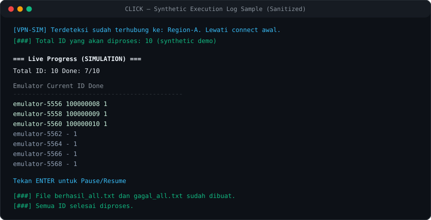
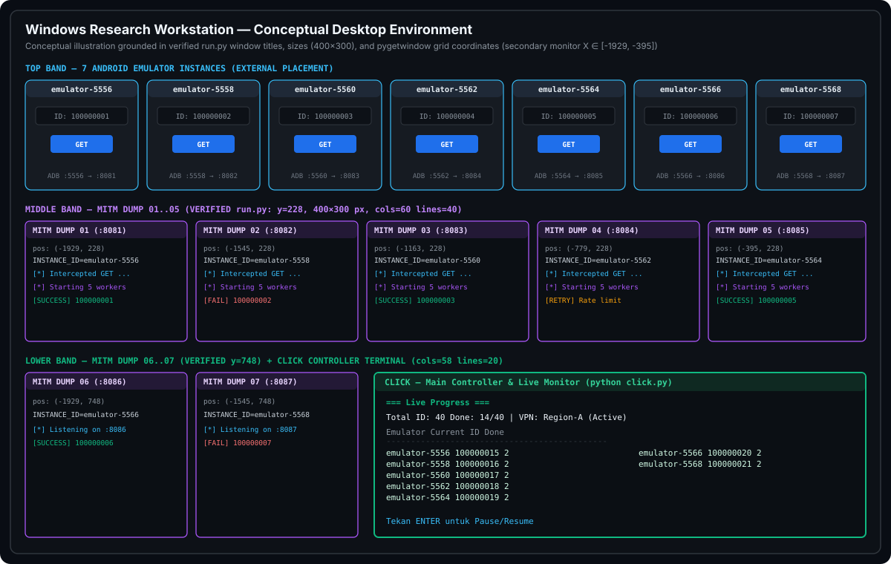

> **Catatan Ruang Lingkup:** Artikel ini mencatat arsitektur *engineering* dan temuan riset keamanan dari *environment* Application Security & Automation yang saya bangun untuk riset internal yang terotorisasi. Seluruh domain produksi, kredensial, data akun asli, gambar tantangan CAPTCHA asli, serta skrip *bypass* operasional tetap disimpan secara privat. Semua angka yang dikutip dari berkas log dan gambar di bawah merujuk pada **sampel bukti eksekusi** (*sample evidence*) dari satu cuplikan sesi.

## 1. Awal Cerita

Pada tahun 2024, saat masih bekerja sebagai *Security Consultant*, saya sedang berada di fase cukup tertarik mendalami dunia *mobile application security*. Mulai dari memahami bagaimana aplikasi Android bekerja, melakukan analisis komunikasi antara aplikasi dan server, sampai mencoba membedah mekanisme keamanan yang ada di dalamnya.

Di periode tersebut, saya mendapatkan tawaran sebuah project yang pada akhirnya menjadi pekerjaan saya selanjutnya. Sebut saja posisi ini sebagai **Application Security & Automation Researcher**.

Awalnya, saya mengira pekerjaan ini akan lebih banyak berkutat pada riset keamanan aplikasi mobile. Namun, setelah mulai memahami ruang lingkup pekerjaannya, ternyata ada tantangan lain yang cukup menarik. Bukan hanya memahami bagaimana aplikasi bekerja, tetapi juga bagaimana menangani proses yang melibatkan banyak akun dengan alur yang berulang.

Menjalankan semuanya secara manual tentu bukan pilihan yang masuk akal. Bayangkan harus membuka aplikasi, melakukan interaksi, dan memproses akun satu per satu melalui emulator. Ketika jumlah akun semakin banyak, pendekatan seperti ini akan memakan banyak waktu.

Di sisi lain, prosesnya juga tidak sesederhana membuat script untuk melakukan klik secara otomatis. Aplikasi yang diteliti memiliki mekanisme *anti-automation*, termasuk *slider CAPTCHA*, yang menjadi tantangan tersendiri dalam proses riset.

Dari situ, pekerjaan ini mulai berkembang menjadi kombinasi antara *mobile reverse engineering*, *application security research*, dan *automation engineering*. Saya perlu memahami mekanisme internal aplikasi sekaligus membangun sistem otomasi yang mampu mengelola proses tersebut secara paralel.

Akhirnya, saya mulai mengembangkan sebuah *environment* otomasi *multi-instance* di Windows: tujuh emulator Android berjalan bersamaan, tujuh proses `mitmdump` yang terisolasi 1:1, dan satu terminal pusat bernama **CLICK** yang menjadi ruang kendali semuanya.

## 2. Kenapa Harus Tujuh Emulator Sekaligus?

Pasti ada yang berpikir:

"Kenapa ga langsung tembak API-nya saja pakai Python tanpa repot-repot menjalankan tujuh emulator Android?"

Tidak semudah itu, Ferguso! Saya pun awalnya berpikir begitu. Namun, dalam praktiknya, banyak aplikasi mobile mengikat alur sensitif dengan parameter sesi sementara (*temporary token*), *state* UI, serta pemicu yang berasal dari dalam aplikasi. Karena itu, menjalankan alur melalui lingkungan Android memberikan konteks yang lebih sesuai dengan perilaku aplikasi sebenarnya dan memudahkan saya melakukan observasi selama proses riset.

Masalahnya, menggunakan satu emulator saja ternyata memiliki beberapa keterbatasan. Pertama, ada jeda dari interaksi UI hingga *network round-trip* yang membuat proses pengujian berjalan cukup lambat. Kedua, saya juga membutuhkan lingkungan yang memungkinkan beberapa sesi berjalan secara paralel agar perilaku aplikasi dalam kondisi tersebut bisa diamati.

Akhirnya, saya memutuskan menggunakan tujuh *instance* emulator Android yang berjalan secara bersamaan. Dengan pendekatan ini, saya bisa membagi antrean pekerjaan secara dinamis, sementara *traffic* dari masing-masing emulator dipisahkan melalui proses interception tersendiri.

Dari sinilah konsep *multi-instance automation* mulai terbentuk. Bukan sekadar menjalankan banyak emulator sekaligus, tetapi bagaimana setiap instance bisa bekerja secara terkoordinasi tanpa mengganggu proses instance lainnya.

## 3. Gambaran Environment Riset

Seluruh *environment* riset ini berjalan pada satu host **Windows** dengan tata letak *multi-monitor*. Jadi, semua komponen utama dikendalikan dari satu mesin, tetapi masing-masing punya tugas dan ruang kerjanya sendiri.

Host tersebut menjalankan tujuh *instance* emulator Android, mulai dari `emulator-5556` hingga `emulator-5568` dengan nomor *port* ADB genap. Setiap emulator menjalankan aplikasi Android custom yang menjadi objek riset. Agar *traffic* dari masing-masing emulator tidak bercampur, setiap instance diarahkan ke *proxy* lokal yang berbeda, menggunakan *port* `8081` hingga `8087`.

Untuk menghubungkan dan mengendalikan seluruh komponen tersebut, saya menggunakan **Python** dengan tiga skrip utama:

1. **`run.py` — Launcher**

   Skrip ini bertugas menjalankan seluruh proses `mitmdump` dan terminal utama. Saya menggunakan library `pygetwindow` untuk mengatur posisi serta ukuran setiap jendela CMD agar aktivitas masing-masing proses bisa dipantau melalui tata letak *multi-monitor*.

2. **`click.py` — Main Controller**

   Bisa dibilang, ini adalah pusat kendali dari keseluruhan environment. Skrip ini mengelola komunikasi dengan emulator melalui ADB, pengaturan koneksi jaringan, serta pembagian pekerjaan menggunakan `threading`. Terminal yang menjalankan skrip ini saya beri nama **CLICK**.

3. **`mitm.py` — mitmproxy Addon**

   Skrip ini dimuat oleh masing-masing proses `mitmdump`. Setiap proses berjalan pada *port* yang berbeda dan menangani *traffic* dari emulator yang terhubung dengannya.

Dengan pembagian seperti ini, setiap komponen memiliki tanggung jawab yang cukup jelas. `run.py` mengurus proses dan tata letak jendela, `click.py` menjadi pengendali utama, sedangkan `mitm.py` menangani kebutuhan observasi *network traffic*.

Jadi, meskipun semuanya berjalan di satu host Windows, environment ini tidak bergantung pada satu proses besar yang mengerjakan semuanya sekaligus.

## 4. Arsitektur Sistem Secara Utuh

Diagram berikut merangkum arsitektur *multi-instance automation* yang berjalan secara bersamaan dalam satu workstation. Total ada **15 jendela aktif**, terdiri dari tujuh emulator Android, tujuh terminal `mitmdump`, dan satu terminal utama **CLICK**.



Sejak awal, saya memang memisahkan tanggung jawab setiap skrip agar alur kerjanya lebih mudah dikelola.

`run.py` bertugas sebagai *launcher*. Skrip ini membuka tujuh terminal `mitmdump`, mengatur posisi masing-masing jendela di monitor, kemudian membuka terminal utama **CLICK** yang menjalankan `click.py`.

Setelah seluruh proses berhasil dijalankan, tugas `run.py` selesai. Skrip ini tidak perlu terus berjalan di latar belakang karena kendali selanjutnya ditangani oleh `click.py` bersama ketujuh proses `mitmdump` yang sudah aktif.

Dengan kata lain, `run.py` hanya bertugas menyiapkan seluruh environment. Setelah itu, `click.py` menjadi pusat kendali untuk mengoordinasikan proses otomasi, sementara masing-masing `mitmdump` menangani *network traffic* dari emulator yang terhubung dengannya.

## 5. Mengelola Tujuh Emulator Android Secara Paralel

Mengkoordinasikan tujuh emulator melalui ADB (`adb -s emulator-55XX shell ...`) ternyata punya satu jebakan. Jika daftar ID dibagi rata secara statis sejak awal, emulator yang bekerja lebih lambat bisa membuat enam emulator lainnya selesai lebih dulu dan akhirnya menganggur sambil menunggu.

Untuk menghindari kondisi tersebut, saya menggunakan pendekatan **shared dynamic work queue** di `click.py`.

Seluruh ID dari `id.txt` dimuat ke dalam satu antrean bersama bernama `all_ids`. Selanjutnya, ketujuh *worker thread* mengambil ID berikutnya melalui fungsi `get_next_id()`. Akses ke antrean ini dilindungi menggunakan `threading.Lock()` agar beberapa thread tidak mengambil ID yang sama secara bersamaan.

Dengan mekanisme ini, setiap emulator akan mengambil pekerjaan berikutnya setelah menyelesaikan tugas sebelumnya. Emulator yang prosesnya lebih cepat secara otomatis bisa memproses lebih banyak ID, sementara emulator yang lebih lambat tidak menghambat keseluruhan antrean.

Selain pembagian pekerjaan, saya juga menjaga pemetaan 1:1 antara *worker*, emulator Android, terminal `mitmdump`, dan *port* proxy yang digunakan. Dengan begitu, setiap worker tetap memiliki pasangan emulator dan jalur *network traffic* masing-masing.



Pendekatan ini membuat pembagian pekerjaan lebih fleksibel dibandingkan pembagian statis. Tidak ada emulator yang harus menunggu jatah pekerjaan dari emulator lain; selama masih ada ID di antrean, worker yang sudah selesai bisa langsung mengambil pekerjaan berikutnya.

## 6. Traffic Interception dengan Tujuh Proses `mitmdump`

Daripada mengarahkan ketujuh emulator ke satu instance `mitmdump`, lalu harus repot memilah request mana yang berasal dari perangkat tertentu, saya memilih menjalankan tujuh proses `mitmdump` secara terpisah.

Setiap proses menggunakan port yang berbeda, mulai dari `8081` hingga `8087`. Saya juga menggunakan flag `-q` (*quiet mode*) agar terminal tidak dipenuhi log bawaan yang kurang relevan. Dengan begitu, output yang tampil bisa lebih fokus pada informasi penting dari addon yang dijalankan.

Untuk membedakan identitas setiap proses, saya menyuntikkan *environment variable* `INSTANCE_ID` sebelum menjalankan `mitmdump`.

Contohnya:

```bat
set INSTANCE_ID=emulator-5556 && mitmdump -q -s mitm.py -p 8081
```

## 7. Riset Keamanan Slider CAPTCHA: Analisis, Temuan, dan Rekomendasi

Salah satu tantangan paling menarik dalam project ini adalah mekanisme **slider CAPTCHA** berbasis gambar yang digunakan untuk melindungi alur sensitif aplikasi.

Saat melakukan observasi *network traffic* melalui `mitmdump` dan menganalisis siklus permintaan tantangan (*challenge-ticket lifecycle*), saya menemukan bahwa layanan CAPTCHA mengirimkan sebuah *sprite sheet* PNG dengan dimensi tetap, yaitu **`340 x 600` piksel** dalam format 8-bit RGBA.

Secara visual, satu *sprite sheet* tersebut terdiri dari tiga area vertikal:

1. **Area atas:** Gambar latar belakang utuh yang telah diacak menjadi 10 potongan vertikal (*vertical strip scrambling*).
2. **Area tengah:** Latar belakang dengan pola pengacakan yang sama, tetapi dilengkapi bayangan potongan puzzle (*cutout shadow*).
3. **Area bawah:** Satu kepingan puzzle yang ditempatkan pada posisi horizontal tetap di sisi kiri kanvas.

Dari struktur tersebut, muncul pertanyaan utama dalam riset saya:

> "Apakah pengacakan potongan vertikal dan mekanisme puzzle slider seperti ini cukup kuat untuk menahan otomasi?"

Setelah melakukan analisis, saya menemukan dua kelemahan arsitektural pada mekanisme yang diteliti.

Pertama, gambar latar belakang dan kepingan puzzle dikirim dalam satu *sprite sheet* dengan struktur dan geometri yang relatif deterministik. Kondisi ini membuka peluang untuk melakukan analisis visual secara terprogram menggunakan pendekatan *computer vision*, termasuk teknik *grayscale template matching*.

Kedua, berdasarkan perilaku verifikasi yang berhasil saya amati dalam lingkup pengujian, validasi di sisi server tampak lebih berfokus pada nilai *horizontal offset* hasil pencocokan. Saya tidak menemukan indikasi validasi tambahan yang memadai terhadap telemetri perilaku, seperti lintasan pergerakan jari, variasi kecepatan, maupun *device attestation*.

**Hasilnya, saya berhasil menembus mekanisme slider CAPTCHA tersebut secara otomatis** melalui analisis citra yang dijalankan secara paralel di lingkungan riset terotorisasi.

Temuan ini menunjukkan bahwa pengacakan gambar menjadi 10 potongan vertikal saja belum tentu cukup untuk mencegah otomasi. Jika struktur visual dan mekanisme verifikasinya masih dapat diprediksi, pendekatan *computer vision* dapat menjadi salah satu cara untuk mengidentifikasi posisi puzzle secara otomatis.

Untuk menjaga publikasi ini tetap berfokus pada analisis keamanan, saya sengaja tidak menyertakan detail koordinat pemotongan, rumus penskalaan *offset*, *endpoint* layanan, maupun skrip operasional yang digunakan selama pengujian.

### Rekomendasi Mitigasi

Berdasarkan temuan tersebut, ada beberapa pendekatan yang dapat dipertimbangkan pengembang untuk memperkuat mekanisme CAPTCHA serupa:

- **Behavioral Telemetry Validation**

  Jangan hanya memvalidasi koordinat akhir slider. Server juga perlu mempertimbangkan pola interaksi, seperti lintasan pergerakan, perubahan kecepatan, konsistensi input sentuhan, dan waktu penyelesaian tantangan. Sinyal-sinyal tersebut sebaiknya dianalisis sebagai bagian dari penilaian risiko, bukan dianggap sebagai bukti tunggal bahwa pengguna adalah manusia.

- **Asset Decoupling dan Dynamic Obfuscation**

  Hindari ketergantungan pada struktur aset visual yang selalu sama. Pemisahan aset, variasi geometri, distorsi dinamis, serta transformasi acak per sesi dapat meningkatkan kesulitan analisis otomatis.

- **App dan Device Attestation**

  Untuk aplikasi Android, mekanisme CAPTCHA dapat dikombinasikan dengan *Play Integrity API* atau mekanisme *device attestation* lainnya. Hasil attestation perlu diikat secara aman dengan sesi dan token tantangan agar tidak mudah digunakan ulang.

- **Layered Risk Scoring**

  CAPTCHA sebaiknya tidak menjadi satu-satunya lapisan perlindungan. Gabungkan hasil validasi tantangan dengan sinyal risiko lain untuk melindungi *endpoint* sensitif, termasuk deteksi anomali sesi dan pola permintaan yang tidak wajar.

Dari riset ini, saya mendapat satu pelajaran menarik: CAPTCHA yang terlihat sulit diselesaikan oleh manusia belum tentu sulit dianalisis oleh mesin. Dalam keamanan aplikasi, tampilan visual yang rumit tidak otomatis berarti mekanisme verifikasinya kuat.

## 8. Terminal `CLICK` dan Manajemen Jaringan

Terminal **CLICK** (`click.py`) merupakan pusat kendali dari keseluruhan environment. Di sinilah antrean pekerjaan, status worker, dan pengaturan jaringan dikoordinasikan.

Ketika `click.py` mulai dijalankan, terdapat jeda `time.sleep(5)` agar ketujuh proses `mitmdump` memiliki waktu untuk menyelesaikan inisialisasi dan siap menerima koneksi dari emulator.

Setelah itu, controller memeriksa status koneksi VPN host melalui fungsi `vpn_status()`. Jika VPN sudah terhubung, controller akan mengadopsi nama server yang sedang aktif. Sebaliknya, jika belum ada koneksi, controller akan menjalankan proses koneksi awal melalui `connect_vpn()`.

Dalam lingkungan riset terotorisasi ini, saya juga mengintegrasikan modul manajemen VPN yang terdiri dari `vpn_status()`, `connect_vpn()`, dan `switch_vpn()`. Pergantian region dilakukan secara berkala setiap kelipatan 200 item yang selesai diproses.

Pengaturan ini digunakan untuk mengamati konsistensi perilaku aplikasi dalam beberapa konteks jaringan dan region *egress* yang berbeda. Dengan demikian, saya bisa melihat bagaimana layanan merespons perubahan konteks jaringan selama sesi pengujian berlangsung.

### Pause dan Resume secara Interaktif

Selain mengatur proses dan jaringan, terminal **CLICK** juga menyediakan fitur **Pause/Resume** agar jalannya pengujian bisa dikendalikan secara interaktif.

Fitur ini dijalankan melalui *daemon thread* `pause_listener()`. Khusus di Windows, saya menggunakan `msvcrt.kbhit()` untuk mendeteksi input keyboard tanpa membuat proses utama ikut terblokir.

Ketika tombol `ENTER` ditekan, mekanisme jeda diaktifkan melalui `resume_event.clear()`. Worker yang sedang menjalankan suatu pekerjaan akan menyelesaikan ID yang sedang diproses terlebih dahulu, kemudian berhenti secara terkoordinasi pada iterasi berikutnya.

Setelah proses dijeda, pengujian dapat dilanjutkan kembali melalui mekanisme Resume. Jadi, saya tidak perlu menghentikan seluruh proses hanya untuk mengambil jeda sementara atau melakukan pemeriksaan kondisi environment.

Pendekatan ini cukup membantu ketika tujuh emulator berjalan bersamaan. Saya tetap memiliki kendali terhadap keseluruhan proses tanpa harus menutup satu per satu terminal yang sedang aktif.

## 9. Multithreading, Sinkronisasi, dan Monitoring

Pada level *thread*, environment ini menggunakan dua lapis konkurensi yang berjalan secara bersamaan.



### Konkurensi pada `click.py`

Di dalam `click.py`, terdapat total **10 thread** yang terlibat dalam pengelolaan proses:

- **1 Main Thread:** Menjalankan alur utama controller dan mengoordinasikan keseluruhan proses.
- **7 Emulator Worker Thread:** Masing-masing bertanggung jawab menangani pekerjaan untuk satu emulator Android.
- **1 `table_updater` Thread:** Memperbarui tabel progres di terminal setiap satu detik agar status pekerjaan dapat dipantau secara berkala.
- **1 `pause_listener` Daemon Thread:** Memantau input keyboard untuk menangani perintah Pause/Resume tanpa memblokir proses utama.

### Konkurensi Internal `mitmdump`

Lapisan kedua berada di dalam masing-masing proses `mitmdump`. Setiap proses dikonfigurasi menggunakan `num_threads = 5` untuk menangani pekerjaan secara paralel.

Karena ada tujuh proses `mitmdump` yang berjalan secara terpisah, konfigurasi ini membuat masing-masing proses memiliki kapasitas konkurensi internalnya sendiri.

### Sinkronisasi antara `click.py` dan `mitm.py`

Salah satu bagian yang cukup unik dari implementasi ini adalah cara `click.py` mengetahui bahwa `mitm.py` telah menyelesaikan pemrosesan suatu ID.

Alih-alih menggunakan komunikasi langsung melalui *socket* atau *message queue*, keduanya menggunakan perubahan waktu modifikasi berkas (*file modification time* atau `mtime`) sebagai indikator penyelesaian proses.

Sebelum memicu pengiriman melalui emulator, `click.py` mencatat nilai timestamp terakhir dari berkas hasil milik emulator tersebut. Setelah itu, controller melakukan pemeriksaan berkala (*polling*) menggunakan `os.path.getmtime()` setiap satu detik hingga mendeteksi perubahan timestamp.

Dengan mekanisme ini, perubahan berkas digunakan sebagai sinyal bahwa ada hasil pemrosesan baru yang perlu diperhatikan oleh controller.

Pendekatan ini memang relatif sederhana karena tidak membutuhkan mekanisme komunikasi antarproses tambahan. Namun, konsekuensinya, sinkronisasi bergantung pada perubahan berkas dan interval polling yang digunakan.

### Penggabungan Hasil

Setelah seluruh antrean pekerjaan habis, *main thread* menunggu ketujuh *worker thread* menyelesaikan tugasnya melalui `.join()`. Thread `table_updater` juga ditunggu agar proses monitoring berhenti dengan rapi.

Setelah seluruh pekerjaan selesai, controller memanggil fungsi `merge_results()` untuk menggabungkan log dari masing-masing emulator menjadi dua berkas hasil akhir:

- `berhasil_all.txt`
- `gagal_all.txt`

Dengan demikian, hasil dari tujuh emulator yang sebelumnya tersebar di masing-masing berkas dapat dikumpulkan ke dalam satu lokasi untuk memudahkan pemeriksaan dan analisis lanjutan.

## 10. Membaca Sampel Bukti Eksekusi (*Sample Evidence*)

Untuk keperluan dokumentasi dan audit ulang, saya menyertakan satu cuplikan sampel eksekusi (*provided execution snapshot*). Paket ini terdiri dari sampel berkas input (`id.txt`), log dari satu instance (`berhasil_emulator-5556.txt` dan `gagal_emulator-5556.txt`), serta tiga sampel gambar tantangan (`capimg_*.png`).

Perlu digarisbawahi bahwa seluruh berkas tersebut merupakan **sampel representatif dari sebagian sesi pengujian**, bukan keseluruhan dataset project. Angka dan temuan yang dibahas pada bagian ini hanya menggambarkan isi sampel yang disertakan.

Log dari `emulator-5558` hingga `emulator-5568` memang tidak disertakan dalam paket sampel analisis ini. Hal tersebut bukan berarti emulator lainnya tidak digunakan, melainkan karena dokumentasi ini hanya menggunakan satu set bukti representatif.

### Membaca Sampel Log

Berdasarkan sampel yang disertakan, terdapat beberapa informasi yang bisa diamati:

- Sampel `berhasil_emulator-5556.txt` memuat **3 catatan sukses**.
- Sampel `gagal_emulator-5556.txt` memuat **19 baris kegagalan** dari **14 ID unik**.
- Sampel `id.txt` berisi **40 ID unik**.
- Tiga gambar `capimg_*.png` memiliki format RGBA dengan dimensi `340 x 600` piksel.

Pada sampel kegagalan, terdapat dua kategori respons server utama, yaitu respons jawaban yang tidak cocok dan respons pembatasan permintaan (*throttling*).

Hal menarik lainnya, ketiga ID yang tercatat berhasil pada sampel log sukses juga pernah muncul sebelumnya dalam sampel log gagal. Pola ini menunjukkan adanya percobaan ulang atau pencatatan dari sesi yang berbeda.

Kondisi tersebut konsisten dengan penggunaan mode append (`'a'`) tanpa mekanisme deduplikasi. Artinya, catatan sebelumnya tetap dipertahankan ketika hasil baru ditambahkan ke berkas yang sama.

### Contoh Tampilan Terminal

Untuk memberikan gambaran mengenai tampilan dasbor **CLICK**, saya menyertakan ilustrasi keluaran sintetis berikut. Data pada ilustrasi ini bukan log asli dan tidak merepresentasikan keseluruhan hasil pengujian.



## 11. Tampilan Desktop Workstation

Ketika tujuh emulator Android dan delapan jendela terminal berjalan bersamaan, penataan layar menjadi bagian penting agar seluruh aktivitas tetap mudah dipantau.

Melalui `run.py`, ketujuh jendela `MITM DUMP` otomatis diatur menggunakan library `pygetwindow`. Masing-masing jendela memiliki ukuran `400 x 300` piksel dan ditempatkan pada monitor kedua yang berada di sisi kiri workstation.

Koordinat penempatannya mengikuti konfigurasi berikut:

- Lima jendela berada di baris atas dengan posisi `y = 228`.
- Dua jendela lainnya berada di baris bawah dengan posisi `y = 748`.
- Posisi horizontal (`x`) tersebar mulai dari `-1929` hingga `-395`.

Sementara itu, tujuh emulator Android ditempatkan di area bagian atas workstation, sedangkan terminal **CLICK** berada di area bawah sebagai pusat pemantauan dan pengendalian proses.



Ilustrasi di atas merupakan representasi konseptual yang disusun berdasarkan koordinat dan ukuran jendela yang dikonfigurasi di `run.py`. Saya menggunakan ilustrasi ini sebagai pengganti tangkapan layar aplikasi target agar dokumentasi tetap berfokus pada arsitektur environment tanpa mengekspos tampilan aplikasi yang menjadi objek riset.

## 12. Penutup

Membangun *environment* otomasi *multi-instance* sekaligus meneliti kelemahan *slider CAPTCHA* menjadi pengalaman yang cukup menarik bagi saya. Dari project ini, saya belajar bahwa riset keamanan aplikasi tidak hanya tentang menemukan celah, tetapi juga memahami bagaimana setiap komponen bekerja, mulai dari komunikasi jaringan, mekanisme aplikasi, hingga konkurensi dalam sistem otomasi yang dibangun.

Ada banyak hal yang bisa dipelajari dari proses ini. Mulai dari mengorkestrasi tujuh emulator secara bersamaan, mengelola proses menggunakan Python *multithreading*, hingga menganalisis kelemahan mekanisme proteksi anti-otomasi menggunakan pendekatan *computer vision*.

Untuk menjaga agar hasil riset tetap bisa dipelajari tanpa mengekspos komponen sensitif, saya mendokumentasikan versi arsitektur dan simulasi yang sudah disanitasi secara terpisah. Repositori publik tersebut berfokus pada pola orkestrasi *multi-emulator*, *multithreading*, dan *desktop automation*, tanpa menyertakan implementasi operasional yang digunakan dalam lingkungan riset asli.

Pada akhirnya, bagi saya, bagian paling menarik dari project ini bukan sekadar berhasil menjalankan tujuh emulator sekaligus atau menemukan kelemahan sebuah mekanisme CAPTCHA, tetapi proses memahami bagaimana semuanya saling terhubung dan bekerja sebagai satu sistem.

Kalau kamu pernah membangun *lab* otomasi mobile atau melakukan riset keamanan terhadap mekanisme anti-otomasi dengan pendekatan berbeda, saya terbuka untuk berdiskusi dan bertukar pengalaman.
